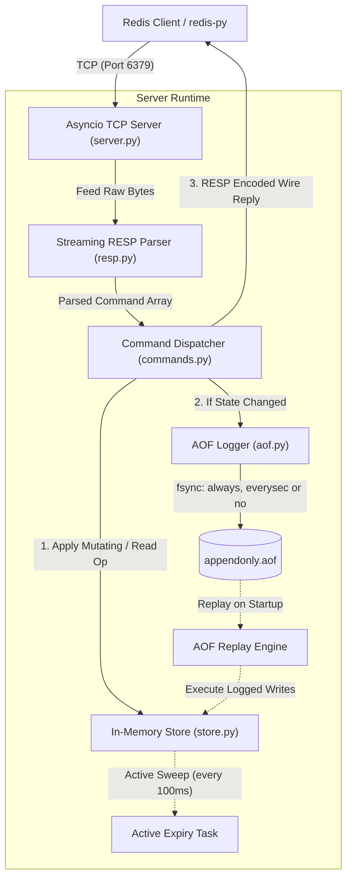

# Mini-Redis

Mini-Redis is a lightweight, Windows-compatible Redis clone implemented purely in Python 3.12+ using only the Python standard library for the server runtime. It implements the RESP2 (Redis Serialization Protocol) wire format over an `asyncio` TCP server on port 6379, providing core string and key management commands (`PING`, `ECHO`, `SET`, `GET`, `DEL`, `EXISTS`), dual-strategy expiration (passive lazy deletion on access combined with active background sampling), and durability via an Append-Only File (AOF) with configurable `fsync` policies (`always`, `everysec`, `no`), canonical absolute-time timestamps, and automatic recovery from mid-write tail truncations.

---

## Architecture



---

## Features

- **Standard Library Server**: Built entirely with Python 3.12+ standard library (`asyncio`, `dataclasses`, `argparse`, `time`, `os`). Dev dependencies (`pytest`, `pytest-asyncio`, `redis-py`) are strictly reserved for testing and validation.
- **Windows-First Compatibility**: All file I/O uses binary mode (`"ab"`, `"rb"`, `"r+b"`). Avoids Unix-only APIs (`fcntl`, epoll) and signals. Connection drops and process terminations are handled cleanly without unhandled tracebacks.
- **RESP2 Protocol**: Complete streaming parser and encoder for Simple Strings (`+`), Errors (`-`), Integers (`:`), Bulk Strings (`$`, including null and empty), Arrays (`*`, including nested and null), and inline command fallbacks.
- **Protocol Safety Limits**: Max bulk string size of 512 MB, max array length of 1,000,000, max nesting depth of 32, and max inline line length of 64 KB.
- **Pipelining**: Batched client writes are parsed and executed consecutively, draining responses in a single TCP frame.
- **Dual Expiration Strategy**:
  - **Lazy Expiry**: Read paths (`GET`, `EXISTS`, `TTL`, `PTTL`) lazily evict expired keys when accessed.
  - **Active Expiry**: An `asyncio` background task samples up to 20 keys every 100 ms and purges expired entries, looping immediately if $>25\%$ were expired (capped at 10 loops to prevent event loop starvation).
- **AOF Persistence**:
  - Canonical absolute timestamps (`PXAT` and `PEXPIREAT`) prevent key revival across server restarts.
  - State-change filtering: Only mutating commands that actually changed state are appended.
  - Crash recovery: Detects incomplete trailing records (mid-write crash) and automatically truncates the file back to the last valid offset while raising `AofCorruptedError` on corrupted records.
  - Configurable `fsync` policies: `always`, `everysec` (background task), and `no`.

---

## Supported Commands

| Command | Syntax | Description |
| :--- | :--- | :--- |
| **`PING`** | `PING [message]` | Tests connection; replies with `+PONG` or the optional message. |
| **`ECHO`** | `ECHO message` | Echoes back the given bulk string. |
| **`SET`** | `SET key value [EX s \| PX ms \| PXAT ms]` | Sets string value with optional expiration. Overwrites clear existing TTL. |
| **`GET`** | `GET key` | Gets string value or `nil` if missing/expired. |
| **`DEL`** | `DEL key [key ...]` | Deletes one or more keys; returns count of keys removed. |
| **`EXISTS`** | `EXISTS key [key ...]` | Checks existence of keys; returns count of existing keys. |
| **`EXPIRE`** | `EXPIRE key seconds` | Sets timeout in seconds; returns `1` if set, `0` if key does not exist. |
| **`PEXPIRE`** | `PEXPIRE key milliseconds` | Sets timeout in milliseconds; returns `1` if set, `0` if key does not exist. |
| **`PEXPIREAT`**| `PEXPIREAT key timestamp_ms` | Sets absolute Unix timestamp expiration in milliseconds. |
| **`TTL`** | `TTL key` | Returns remaining TTL in seconds (`-2` if missing, `-1` if no expiry). |
| **`PTTL`** | `PTTL key` | Returns remaining TTL in milliseconds (`-2` if missing, `-1` if no expiry). |
| **`PERSIST`** | `PERSIST key` | Removes timeout on key; returns `1` if removed, `0` otherwise. |

---

## Design Decisions

1. **Canonical Absolute-Time AOF Records (`PXAT` / `PEXPIREAT`)**:
   Relative TTLs (`EX 10`) cannot be logged directly to an append-only file because replaying that log days or weeks later would grant the key an extra 10 seconds of lifetime. All expiration options in `SET` and `EXPIRE` are canonicalized to their absolute millisecond timestamps (`PXAT <epoch_ms>` and `PEXPIREAT <epoch_ms>`).
2. **Strict Write-Ahead Ordering (Apply $\to$ Log $\to$ Reply)**:
   A client must never receive a `+OK` reply for a state modification that hasn't been written to the AOF buffer. Commands are first applied to memory to determine whether state changed, appended to the AOF (and fsynced if `always`), and only then is the response queued for network transmission.
3. **Lazy + Active Expiry Hybrid**:
   Passive lazy checks guarantee zero stale reads on any command invocation. However, keys that are never read again would leak memory indefinitely without an active sweeper. The 100 ms active background task samples randomized batches and dynamically increases frequency if the expiration density exceeds $25\%$.
4. **Truncated-Tail Recovery vs. Corrupted Middle Abort**:
   When a process crashes or power is lost mid-write, the last record in the AOF may be partially written. Replay recognizes incomplete records at EOF (`IncompleteDataError`), truncates the file back to the end of the last complete record, logs a warning, and continues startup. Conversely, syntax corruptions in the middle of the log raise `AofCorruptedError` and prevent startup to avoid silent data loss.
5. **Always Fsync Blocking the Event Loop (Durability vs. Throughput Trade-off)**:
   In Python standard library `asyncio`, file descriptors on disk do not support asynchronous `fsync` out of the box without threads. Calling `os.fsync` synchronously in `--appendfsync always` guarantees durability before replying to the client, but intentionally limits single-threaded throughput (~1,291 ops/sec vs ~9,454 ops/sec with `everysec`).

---

## How to Run & Test (Windows)

### 1. Prerequisites & Environment Setup
```powershell
python -m venv .venv
.\.venv\Scripts\Activate.ps1
pip install -r requirements.txt
```

### 2. Start the Server
```powershell
# Default (port 6379, AOF everysec)
python -m mini_redis.server

# Custom host, port, and AOF configuration
python -m mini_redis.server --host 127.0.0.1 --port 6379 --aof-path appendonly.aof --appendfsync everysec

# Run with AOF disabled
python -m mini_redis.server --no-aof
```

### 3. Run the Smoke Test
```powershell
python scripts\smoke_test.py
```

### 4. Run the Full Test Suite
```powershell
pytest -v
```

### 5. Run the Benchmark
```powershell
# Compare fsync policies across 50,000 commands
python bench.py -n 50000 -c 10

# Test against a running server
python bench.py --port 6379 -n 50000 -c 10
```

---

## Benchmark Results

### Benchmark Environment
- **Date**: 2026-10-13 11:26:37
- **OS**: Windows 11 (64bit)
- **Machine**: Intel64 Family 6 Model 170 Stepping 4, GenuineIntel
- **Python**: 3.13.5 (CPython)
- **Parameters**: 50,000 commands, 10 concurrent connections, pipeline depth = 1

### Performance Results

| Fsync Policy | Operation | Ops/sec | p50 Latency (ms) | p99 Latency (ms) | Total Time |
| :--- | :--- | :---: | :---: | :---: | :---: |
| `no` | **SET** | 4,924.9 | 2.052 | 5.206 | 10.15s |
| `no` | **GET** | 8,016.2 | 0.849 | 3.609 | 6.24s |
| `everysec` | **SET** | 9,454.0 | 0.963 | 2.082 | 5.29s |
| `everysec` | **GET** | 12,704.4 | 0.695 | 1.785 | 3.94s |
| `always` | **SET** | 1,291.3 | 7.444 | 11.564 | 38.72s |
| `always` | **GET** | 12,523.8 | 0.698 | 1.705 | 3.99s |

---

> **Note:** one run per policy, with a Python load generator on the same machine and no pipelining, so treat these numbers as indicative only. Run-to-run variance is large: the 'no' policy measured slower than 'everysec' even though it should not be, which is most likely noise.

## Limitations & Future Work

- **Data Structures**: Only string values are supported; no lists, hashes, sets, sorted sets, or streams.
- **AOF Compaction**: No background AOF rewrite (`BGREWRITEAOF`) or point-in-time RDB snapshots; the AOF file grows monotonically.
- **Transactions & Pub/Sub**: No `MULTI`/`EXEC` atomic blocks or `PUBLISH`/`SUBSCRIBE` messaging.
- **Replication & Clustering**: Single-node server only; no primary-replica synchronization or sharding.
- **Threaded Fsync**: `always` fsync blocks the event loop thread; offloading `os.fsync` to a dedicated disk-writer thread or worker executor would improve concurrency under synchronous fsync policies.

---

## License

MIT License. See [LICENSE](LICENSE) for details.
